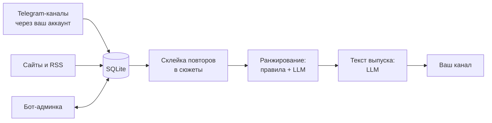

# Telegram AI Digest

[Русский](#русский) · [English](#english)

## Русский

Бот дважды в день собирает новости про ИИ из Telegram-каналов и с сайтов, склеивает повторы в сюжеты,
отбирает главное с помощью LLM и публикует в ваш канал один выпуск из двух блоков: «Новости» и «Полезное».
Повторы между выпусками не попадают.

### Пример выпуска

> **Утренний AI-дайджест**
>
> **Новости**
>
> 1. **Google Cloud открыл доступ к моделям OpenAI**
> Клиенты получают модели OpenAI прямо в инфраструктуре Google Cloud: больше выбора и меньше привязки к одному вендору.
> Источник
>
> 2. **Walmart пускает AI-агентов за покупками, Amazon их блокирует**
> Агенты покупают за клиента с лимитом трат и подтверждением, Amazon закрывает сайт от таких агентов.
> Источник
>
> **Полезное**
>
> 3. **Пять проблем мультиагентных систем в продакшене и как их решают**
> Разбор AWS: оркестрация, выбор модели под агента, надёжность.
> Источник

### Что умеет

- Читает выбранные Telegram-каналы через ваш аккаунт и 13 блогов по умолчанию (OpenAI, Anthropic, Google,
  DeepMind, Microsoft, AWS, NVIDIA, Hugging Face, TechCrunch, The Verge и другие), список меняется.
- Склеивает одну новость из разных источников в один сюжет, отсеивает рекламу и анонсы вебинаров.
- Ранжирует сюжеты: правила (свежесть, подтверждение несколькими источниками, официальный источник) плюс
  оценка LLM. Ограничивает число сюжетов от одного источника.
- Пишет текст выпуска на русском через LLM; если LLM недоступен, собирает выпуск без него.
- Управляется из Telegram ботом-админкой: источники, промпт и стиль, расписание, выпуск сейчас или по
  теме, краткое содержание чата, сводка непрочитанных каналов, статус.

### Как устроено



Python 3.12, aiogram (бот), Telethon (чтение каналов), APScheduler (расписание), SQLite, httpx.
LLM по умолчанию DeepSeek, подойдёт любой OpenAI-совместимый API.

### Запуск

Понадобятся:
- `TELEGRAM_API_ID` и `TELEGRAM_API_HASH` на https://my.telegram.org (API development tools);
- бот от @BotFather, добавленный админом в канал для публикации;
- ключ LLM API (DeepSeek или другой OpenAI-совместимый);
- ваш Telegram id (например, у @userinfobot).

```bash
git clone https://github.com/olshanskiyad/telegram-ai-digest.git
cd telegram-ai-digest
cp .env.example .env        # заполнить значения
docker compose run --rm ai-news-digest python scripts/login.py   # один раз: телефон и код из Telegram
docker compose up -d --build
```

Затем откройте своего бота в Telegram, нажмите /start и добавьте каналы-источники: «📡 Источники TG» →
«➕ Добавить TG источник», потом перешлите боту пост из канала или пришлите ссылку. Аккаунт-читатель должен быть
подписан на эти каналы: сам он вступает только по ссылке-приглашению. Выпуски выходят в канал
по расписанию, кнопка «Собрать сейчас» присылает вам в бот черновик выпуска.

Без Docker:

```bash
python3.12 -m venv .venv && . .venv/bin/activate
pip install -r requirements.txt
python scripts/login.py
PYTHONPATH=src python -m ai_news_digest.main
```

### Настройки

Все настройки в `.env`, описание в [.env.example](.env.example). Расписание и состав выпуска при первом запуске
записываются в базу; расписание потом меняется в боте кнопкой «Расписание» и применяется после перезапуска. Главные:

| Переменная | Что задаёт |
|---|---|
| `PUBLISH_CHAT_ID` | канал, куда выходит дайджест |
| `MORNING_DIGEST_TIME`, `EVENING_DIGEST_TIME`, `TIMEZONE` | время выпусков |
| `DEFAULT_NEWS_COUNT`, `DEFAULT_USEFUL_COUNT` | сколько пунктов в блоках |
| `DEDUP_WINDOW_DAYS` | за сколько дней не повторять сюжеты |
| `DEEPSEEK_BASE_URL`, `DEEPSEEK_CHAT_MODEL` | какой LLM API и модель использовать |

### Важно

- Каналы читаются через обычный аккаунт Telegram (Telethon). Используйте свой аккаунт и соблюдайте правила
  Telegram. Файл сессии даёт полный доступ к аккаунту: храните его как пароль, в git он не попадает.
- В LLM уходят тексты постов и статей для выпуска. Для «Суммаризировать чат» и «Непрочитанные каналы» туда
  уходят сообщения выбранного чата или ваших каналов, в том числе имена и ники авторов: выбирайте LLM-провайдера
  с этим учётом. Всё хранится локально в SQLite.

### Тесты

```bash
pip install -r requirements.txt pytest && pytest
```

## English

A bot that collects AI news twice a day from Telegram channels and websites, merges duplicates into stories,
ranks them with an LLM and posts one digest to your channel with two blocks: News and Useful. Stories are
not repeated across digests. The digest and the admin bot are in Russian.

**Features:** reads chosen Telegram channels through your account plus 13 default AI blogs; merges the same
news from different sources; filters ads and webinar announcements; ranks with rules (freshness,
cross-source confirmation, official source) plus an LLM score; caps stories per source; writes the digest
with an LLM and falls back to a template if the LLM is down; a Telegram admin bot manages sources, prompt,
schedule, draft and topic digests, chat summaries and unread-channel summaries.

**Stack:** Python 3.12, aiogram, Telethon, APScheduler, SQLite, httpx. DeepSeek by default, any
OpenAI-compatible API works.

**Quick start:** get `TELEGRAM_API_ID`/`TELEGRAM_API_HASH` at https://my.telegram.org, a bot token from
@BotFather (add the bot as an admin of your channel), an LLM API key and your Telegram user id. Then:

```bash
cp .env.example .env
docker compose run --rm ai-news-digest python scripts/login.py   # once: phone number and login code
docker compose up -d --build
```

Open your bot, press /start, go to «📡 Источники TG» → «➕ Добавить TG источник» and forward a post from a
channel or send its link. The reader account must be subscribed to these channels (it joins by itself only via an
invite link). Digests are posted on schedule; «Собрать сейчас» sends you a draft in the bot.
The schedule and digest size are copied from `.env` to the database on first start; the schedule can then be
changed in the bot (applied after a restart).

**Notes:** channels are read with a regular Telegram account (Telethon): use your own account and follow
Telegram's terms. The session file grants full account access, keep it secret. Post and article texts are
sent to the LLM; chat summaries and unread-channel summaries also send messages of the chosen chat or your
channels, including author names, so pick your LLM provider accordingly. Data is stored in local SQLite.

**Tests:** `pip install -r requirements.txt pytest && pytest`

## License

MIT, see [LICENSE](LICENSE). Author: Andrey Olshanskiy.
